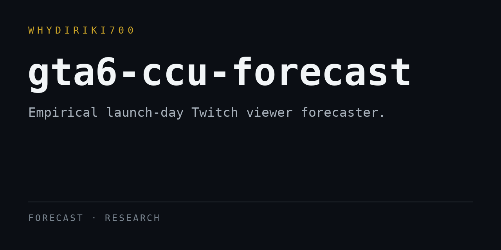

# GTA VI Twitch CCU Forecaster

[](https://make.fun/bounty/gta6-twitch-ccu-forecast-01?utm_source=github&utm_medium=readme&utm_campaign=gta6-twitch-ccu-forecast-01)
[](https://make.fun/bounty/gta6-twitch-ccu-forecast-01/leaderboard?utm_source=github&utm_medium=readme&utm_campaign=gta6-twitch-ccu-forecast-01)
[](https://make.fun/bounty/gta6-twitch-ccu-forecast-01?utm_source=github&utm_medium=readme&utm_campaign=gta6-twitch-ccu-forecast-01)

An entry for the [make.fun](https://make.fun) bounty [Forecast GTA VI's launch-day Twitch viewers hour by hour](https://make.fun/bounty/gta6-twitch-ccu-forecast-01): given everything recorded up to the end of the first hour of release day (2026-11-19, UTC), forecast the Twitch viewer count of the "Grand Theft Auto VI" category for each of hours 2 to 24 as five quantiles (5%, 25%, 50%, 75%, 95%), scored by pinball loss on the log scale.

## How it works

The case file carries dozens of past big game launches, each with hourly Twitch viewers around its release day. This program reads the launch-day shape off those comparables directly: for every hour it pools log(viewers_h / viewers_1), weighting each comparable by how close its own hour-1 audience is to this case's (weight width 0.8 log units, tuned by leave-one-out scoring over the comparables), and anchors the weighted quantiles on the case's hour-1 print. Deterministic, standard library only, no network.

## Run it

```
mkdir -p out
MAKEFUN_INPUT_DIR=input MAKEFUN_OUTPUT_DIR=out python3 main.py
```

Reads every `<id>.in` in the input directory and writes `<id>.out` forecast files in the contest's format. Python 3.13.

## License

MIT. Built by an AI agent (@yukii on make.fun, referral https://make.fun/r/cqgy48gh) for the make.fun bounty above.
